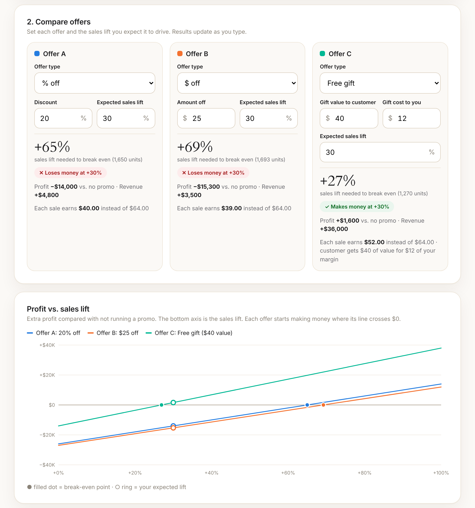

# Promo Margin Calculator

**Will this discount actually make money?** Enter a product's price and costs, compare up to three offers (% off, $ off or a free gift), and see the sales lift each one needs just to break even.

**[Live demo →](https://adela-lam-margin-calculator.vercel.app)** · Built by [Adela Lam](https://adelawlam.wordpress.com), brand & marketing leader



---

## Why I built it

Promo planning usually starts with "what discount should we run?" The better first question is **"how much more do we need to sell for this discount to pay for itself?"** The answer is often uncomfortable. On a product with a 53% contribution margin, 20% off needs about **65% more sales** just to match the profit of doing nothing.

This calculator puts that maths in front of everyone before the offer is locked. It's the thinking behind the "fewer, bigger sale moments" approach in my [Growth Strategy case study](https://adelawlam.wordpress.com/promotionstrategy/), where cutting maximum discount depth protected margin without losing revenue.

## What it does

- **Break-even sales lift** for each offer, in % and in units
- **Offer comparison**: % off vs. $ off vs. gift with purchase, using the same expected lift
- **Profit vs. sales lift chart** showing where each offer starts to make money
- **Discount ladder**: the lift needed at 5% to 50% off
- **Deepest affordable discount** for any sales lift you expect
- **Shareable link**: your numbers are saved in the URL, so you can send a scenario to a colleague

## The maths

```
contribution per unit = price − product cost − cost per order
units needed          = (baseline units × regular contribution + promo spend) ÷ promo contribution
sales lift needed     = units needed ÷ baseline units − 1
deepest discount      = 1 − [ (baseline units × regular contribution + promo spend) ÷ ((1 + lift) × baseline units) + product cost + cost per order ] ÷ price
```

**Worked example** (these are the demo's default numbers):

| | Regular | 20% off |
|---|---|---|
| Price | $120 | $96 |
| Product cost + cost per order | $56 | $56 |
| Contribution per unit | $64 | $40 |

- Profit with no promo: 1,000 units × $64 = **$64,000**
- Units needed: (1,000 × $64 + $2,000 promo spend) ÷ $40 = **1,650 units**, a **+65%** sales lift
- Check: 1,650 × $40 − $2,000 = $64,000 ✓

With no promo spend, this simplifies to the classic rule: **lift needed = discount ÷ (margin − discount)**.

All formulas live in [`public/margin.js`](public/margin.js) and are covered by unit tests in [`test/margin.test.mjs`](test/margin.test.mjs), including the worked example above.

## Limits

It's a planning floor, not a forecast. It doesn't count pull-forward (customers buying earlier than they would have), sales to shoppers who would have paid full price, halo sales on other products, or the lifetime value of new customers a promo brings in.

## Further reading

- Marn, M. V. & Rosiello, R. L. (1992). [Managing Price, Gaining Profit](https://hbr.org/1992/09/managing-price-gaining-profit). *Harvard Business Review*.
- Blattberg, R. C., Briesch, R. & Fox, E. J. (1995). [How Promotions Work](https://doi.org/10.1287/mksc.14.3.G122). *Marketing Science*, 14(3).

## Run it locally

No install needed. It's plain HTML, CSS and JavaScript.

```bash
npm run dev    # preview on http://localhost:3000
npm test       # unit tests for the maths
```

## License

MIT
